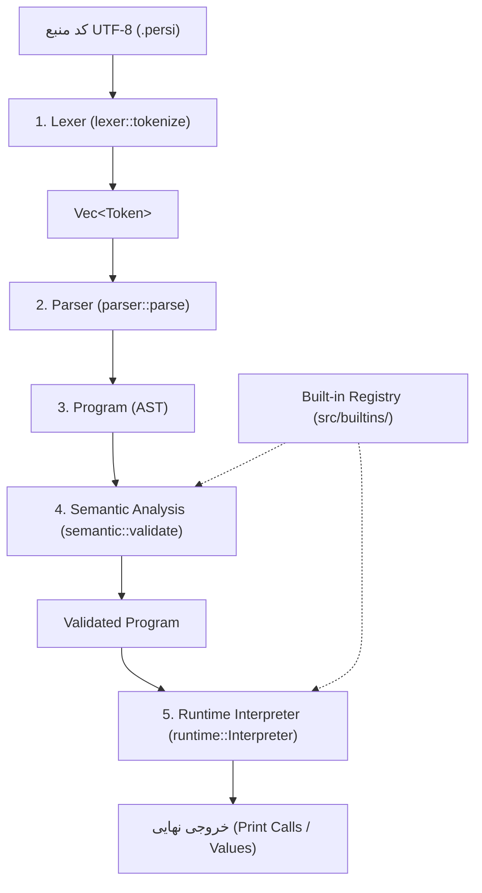

# 01 - Architecture & Pipeline 🏗️

پرسیکا یک مفسر چندمرحله‌ای (Multi-stage Tree-walk Interpreter) است که با هدف سادگی، خوانایی، نوع‌دهی ایستا و بدون وابستگی خارجی (Zero Dependencies) در Rust نوشته شده است.

---

## 🔄 خط لوله اجرا (Execution Pipeline)

---

## 🧩 مرز و وظایف لایه‌ها

### ۱. تحلیل‌گر لغوی ([[02 - File Catalog#Lexer|Lexer]])
- **وظیفه:** تبدیل متن خام به دنباله‌ای از Tokenها.
- **مسئولیت‌ها:** مدیریت فاصله‌ها، کامنت‌های خطی (`//`) و چندخطی (`/* */`)، رشته‌های چندخطی، نویسه‌های یونیکد، کاراکترهای اسکیپ (`\n`, `\t`...)، اعداد اعشاری و صحیح.
- **خط قرمز:** به هیچ وجه درباره ساختار دستوری یا نوع متغیرها تصمیم نمی‌گیرد.

### ۲. تجزیه‌کننده ([[02 - File Catalog#Parser|Parser]])
- **وظیفه:** تبدیل توکن‌ها به درخت گرامری انتزاعی ([[02 - File Catalog#AST|AST]]).
- **الگوریتم:** Recursive Descent همراه با جدول تقدم عملگرها (Precedence Climbing).
- **مسئولیت‌ها:** تضمین رعایت دستور زبان، مدیریت عبارات و تقدم عملگرها، پارس بلوک‌ها، تعریف توابع، دستورات کنترلی (`if`, `while`, `for`, `for-in`) و لیترال‌های پیچیده (آرایه‌ها و مپ‌ها).

### ۳. تحلیل‌گر معنایی ([[02 - File Catalog#Semantic|Semantic Analyzer]])
- **وظیفه:** اعتبارسنجی منطق برنامه قبل از اجرا (Type Checking و Scope Resolution).
- **مسئولیت‌ها:**
  - مدیریت پشته Scopeها و جدول نمادها (Symbol Table).
  - بررسی نوع عبارات، تخصیص‌ها و برابری نوع داده در فراخوانی توابع.
  - اعتبارسنجی دستورات کنترلی (`break` و `continue` فقط داخل حلقه باشند، `return` فقط داخل تابع باشد).
  - جلوگیری از بازتعریف متغیرهای ثابت (`final`) یا نام‌های رزرو شده (`RESERVED_BUILTINS`).
  - بررسی سازگاری نوع `any` و جنریک‌های `map<K, V>`.

### ۴. مفسر زمان اجرا ([[02 - File Catalog#Runtime|Runtime Interpreter]])
- **وظیفه:** اجرای گام‌به‌گام درخت AST تأییدشده.
- **مسئولیت‌ها:**
  - ارزیابی عبارات به مقادیر `Value`.
  - مدیریت محیط‌های متغیرها (Bindings) با پشتیبانی از Scope زنجیره‌ای.
  - فراخوانی توابع تعریف‌شده توسط کاربر و مدیریت بازگشت مقادیر (`Flow::Return`).
  - فراخوانی توابع داخلی رجیستری و توابع با وضعیت داخلی (`input`, `range`, `print`).
  - جهش آرایه‌ها و مپ‌ها در زمان اجرا با حفظ ایمنی حافظه.

---

## 🛡️ سیستم خطا و اصل عدم Panic
یکی از مهم‌ترین invariantهای معماری پرسیکا:
> **خطای برنامه کاربر در هیچ شرایطی نباید باعث `panic!` در Rust شود.**
> تمام خطاها در قالب struct به نام `Diagnostic` با فاز مشخص (`Phase::Lexer`, `Phase::Parser`, `Phase::Semantic`, `Phase::Runtime`) و مختصات خط و ستون (`Span`) به عنوان `Result::Err` برگردانده می‌شوند.
